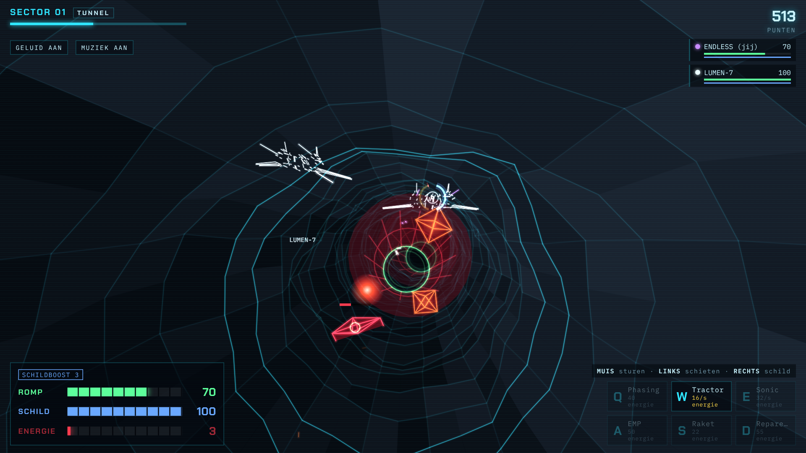
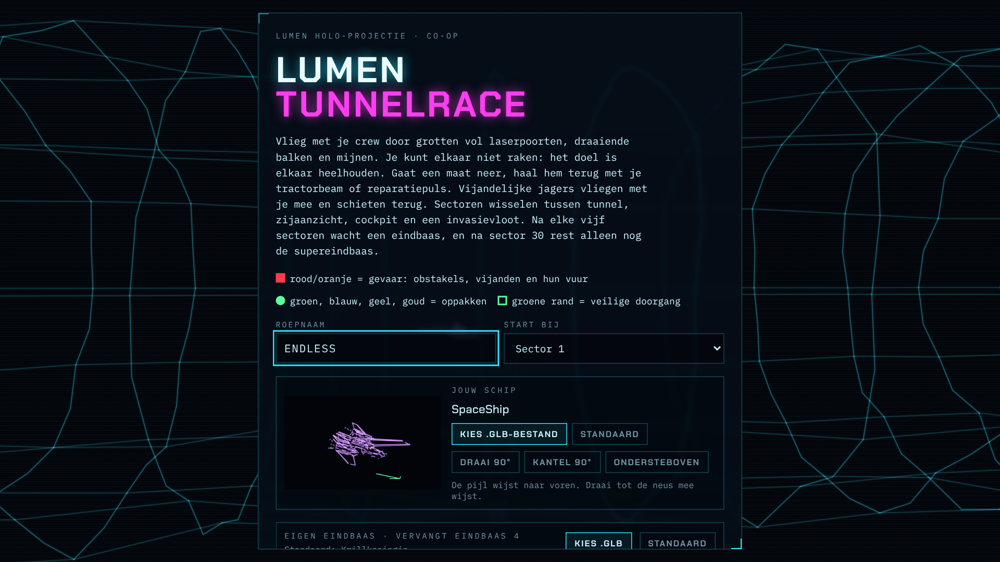
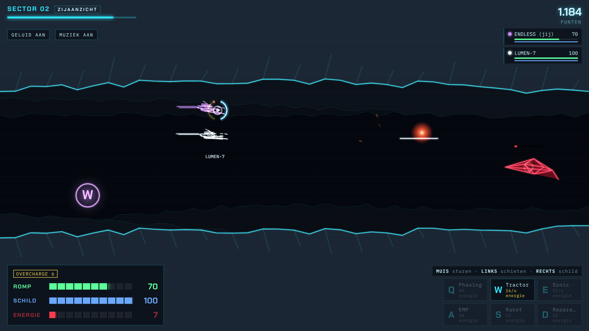
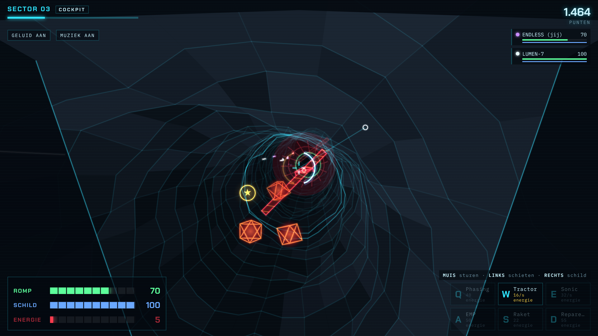
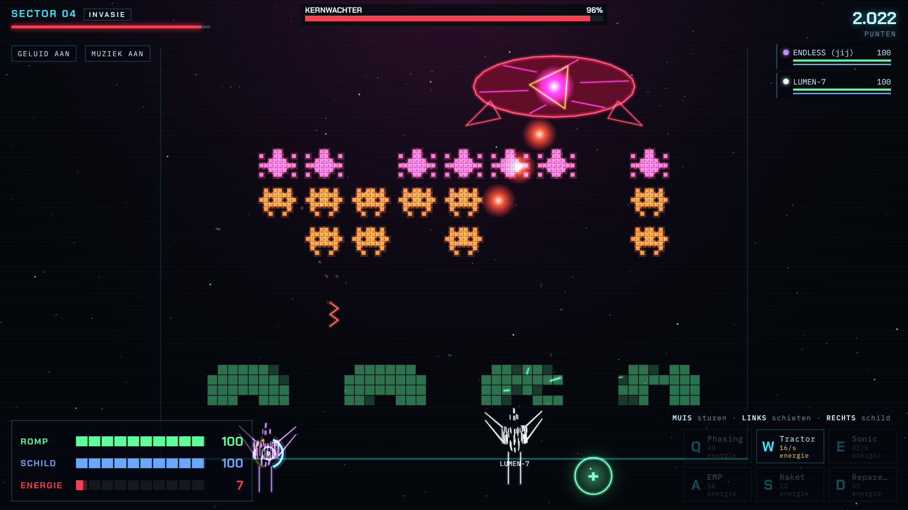
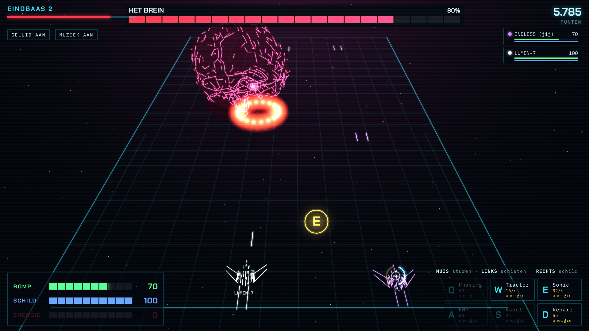
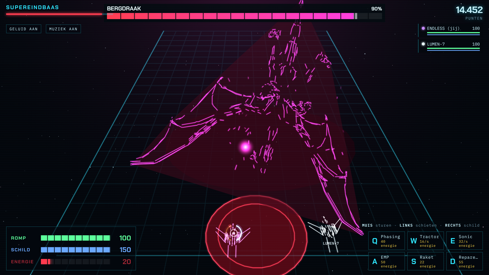
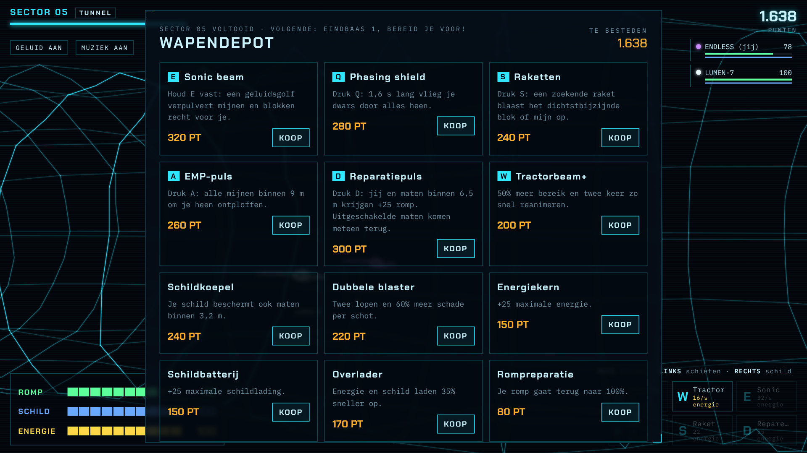
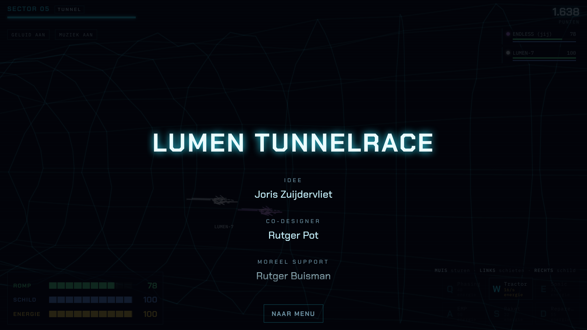

# Lumen Tunnelrace

Co-op multiplayer 3D tunnelrace in Lumen-hologramstijl: laser-wireframes, gloeiende grotten en een crew die elkaar in leven houdt.

**▶ Spelen:** https://endless1977.github.io/TunnelRace/

Je vliegt met je crew door grotten vol laserpoorten, draaiende balken, mijnen en vijandelijke jagers. Je kunt elkaar niet raken: het doel is juist elkaar heelhouden. Gaat een maat neer, dan haal je hem terug met je tractorbeam of reparatiepuls. Zijn alle schepen uit, dan is de run voorbij.

Het hele spel is één HTML-bestand. Het draait direct in de browser (Chrome of Edge aanbevolen), zonder installatie en zonder server.

## Wat zit erin

- **Vier soorten sectoren**: tunnel (van achter je schip), zijaanzicht (met eigen obstakels zoals stalactieten en pletters), cockpit (vanuit je stoel) en een invasievloot in arcadestijl.
- **Vijanden die terugschieten**: jagers en kanonneerboten vliegen met je mee en vuren op je.
- **Eindbazen** na elke vijf sectoren, gemodelleerd naar echte 3D-modellen, met een grote levensbalk bovenin. Ze schieten, slaan en stormen op je af.
- **Supereindbaas** in sector 30. Wie die verslaat, krijgt de aftiteling te zien.
- **Energie en schild** laden vanzelf op zodra je ze even niet gebruikt. Schieten, schild en speciale wapens kosten energie.
- **Pickups**: overcharge, wapenboost, schildboost, rompreparatie en punten.
- **Wapendepot** tussen de sectoren, waar je verdiende punten uitgeeft aan nieuwe wapens en upgrades.
- **Eigen schip en eigen eindbaas**: laad een `.glb`-bestand en het spel maakt er een laser-wireframe van.
- **Eigen muziek per sector**, live gegenereerd in de browser: rustige orgelklanken met polyritmes in de sectoren, opzwepende breakbeat bij de eindbazen.
- **Solo** met de AI-drone LUMEN-7 als maat, of **online** met vrienden.

## Besturing

| Invoer | Actie |
|---|---|
| Muis | Sturen (in de cockpit werkt de muis als joystick vanuit het midden) |
| Linkermuisknop | Schieten |
| Rechtermuisknop | Schild |
| **Q** | Phasing: 1,6 s door alles heen vliegen |
| **W** (vasthouden) | Tractorbeam: maat naar je toe trekken of reanimeren |
| **E** (vasthouden) | Sonic beam |
| **A** | EMP-puls: mijnen en vijandelijk vuur in de buurt vernietigen |
| **S** | Zoekende raket |
| **D** | Reparatiepuls: +25 romp voor jou en maten dichtbij |
| Pijltjes, spatie, shift | Sturen, schieten en schild zonder muis |

Op een telefoon of tablet verschijnen een joystick en knoppen op het scherm. Q, E, A, S en D koop je eerst in het wapendepot.

**Kleuren lezen:** rood en oranje is gevaar (obstakels, vijanden en hun vuur). Een groene rand is een veilige doorgang. Ronde gloeiende bollen pak je op.

## Samen spelen

1. Iedereen opent https://endless1977.github.io/TunnelRace/.
2. Eén speler kiest **Online crew → Nieuwe kamer** en geeft de code van vier tekens door.
3. De anderen kiezen **Online crew**, vullen de code in en kiezen **Instappen**.
4. Iemand drukt op **Lanceer crew** en iedereen start tegelijk in dezelfde tunnel.

Spelers verbinden rechtstreeks met elkaar via PeerJS (WebRTC). Wie later instapt, doet mee vanaf de volgende sector. Valt de host weg, dan neemt een andere speler de kamer automatisch over. Bij de eindbazen delen jullie één levensbalk.

## Opbouw van een run

Elk blok van zes sectoren loopt zo: tunnel, zijaanzicht, cockpit, invasie, nog een sector en dan een eindbaas.

| Sector | Eindbaas |
|---|---|
| 6 | Krill-kolos |
| 12 | Het Brein |
| 18 | Soulthirsty Mawko |
| 24 | Krillkoningin (of je eigen `.glb`-model) |
| 30 | **Bergdraak**, de supereindbaas |

Via **Start bij** in het menu kun je direct bij een eindbaas beginnen. Je krijgt dan een passend wapenpakket mee.

## Screenshots

| | |
|---|---|
|  |  |
| **Menu** met schipkeuze | **Zijaanzicht** door de grot |
|  |  |
| **Cockpit**: vliegen vanuit je stoel | **Invasie** tegen de Kernwachter |
|  |  |
| **Eindbaas 2**: Het Brein vuurt een ring van kogels af | **Supereindbaas**: de Bergdraak haalt uit |
|  |  |
| **Wapendepot** tussen de sectoren | **Aftiteling** na de Bergdraak |

## Credits

- **Idee:** Joris Zuijdervliet
- **Co-designer:** Rutger Pot
- **Moreel support:** Rutger Buisman
- **Gebouwd met:** Claude

**Opgedragen aan Gele Ogen Martin.**

### 3D-modellen

Alle modellen staan onder de licentie [CC BY 4.0](http://creativecommons.org/licenses/by/4.0/). In het spel zijn ze omgezet naar laser-wireframes.

| Model | Maker | Gebruikt als |
|---|---|---|
| [SpaceShip](https://sketchfab.com/3d-models/spaceship-6164a883f57f4f13938c3c5999bc0e1f) | JazOone | Standaardschip |
| [Creature Krill](https://sketchfab.com/3d-models/creature-krill-3a0cc449cb7247e19a2546ec776985e0) | [Henkoi](https://sketchfab.com/Henkoi) | Krill-kolos en Krillkoningin |
| [Human Brain](https://sketchfab.com/3d-models/human-brain-7a27c17fd6c0488bb31ab093236a47fb) | [3DRT STUDIOS](https://sketchfab.com/Hanako.com) | Het Brein |
| [Soulthirsty Mawko](https://sketchfab.com/3d-models/soulthirsty-mawko-832701d0918b4e5bb15408d1097b6f13) | [Spinnee](https://sketchfab.com/Spinnee) | Soulthirsty Mawko |
| [Mountain Dragon](https://sketchfab.com/3d-models/mountain-dragon-0a0665396f634b0e9d0872720087f52c) | [Alexey Zaika](https://sketchfab.com/lexazaixa25) | Bergdraak |

Online spelen gebeurt via [PeerJS](https://peerjs.com/). De lettertypen zijn Chakra Petch en IBM Plex Mono van Google Fonts.
